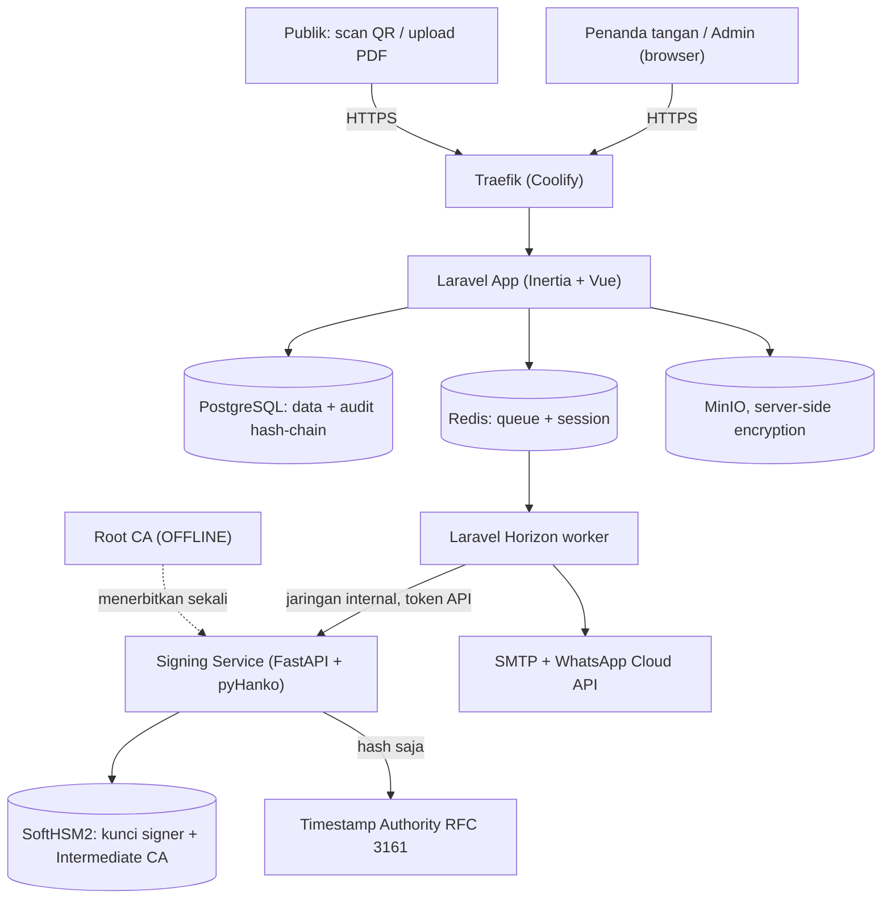
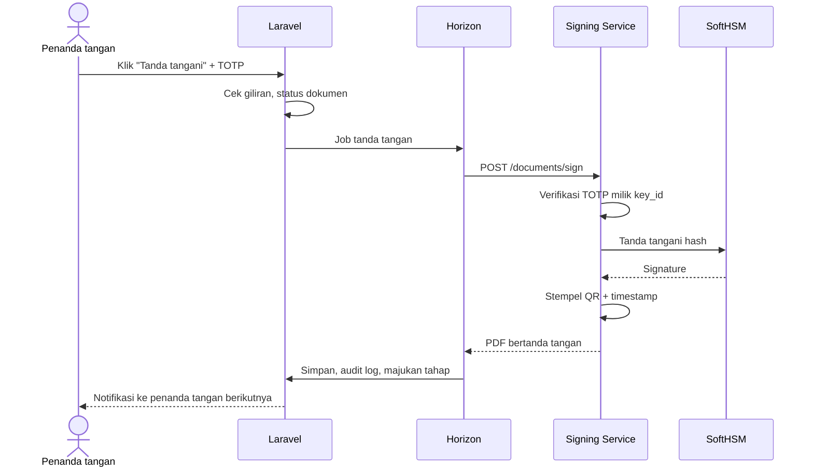

# Arsitektur Sistem TTE QR Internal

Status: **Disetujui** (2026-11-21)

## 1. Tujuan

Aplikasi tanda tangan elektronik (TTE) internal untuk satu instansi. Setiap tanda tangan
adalah tanda tangan kriptografis PAdES di dalam PDF, disertai stempel QR yang menuju
halaman verifikasi publik.

Status hukum: TTE **tidak tersertifikasi** (sah menurut UU ITE, kekuatan pembuktian di bawah
TTE dari PSrE). Jalur migrasi ke PSrE tersedia lewat adapter di Signing Service.

## 2. Kebutuhan

### Fungsional
- F1. Pengguna meng-upload PDF dan menaruh kotak QR untuk setiap penanda tangan (pdf.js).
- F2. Alur multi-penanda tangan **berurutan**, dengan status per tahap.
- F3. Setiap aksi tanda tangan wajib konfirmasi TOTP.
- F4. Verifikasi publik lewat scan QR dan lewat upload PDF.
- F5. Pencabutan dokumen dan pencabutan sertifikat penanda tangan.
- F6. Audit log anti-ubah (hash-chain).
- F7. Notifikasi email (SMTP) dan WhatsApp (Cloud API resmi) — hanya berisi tautan.

### Non-fungsional
- Skala: 1 instansi, < 50 penanda tangan, ratusan–ribuan dokumen/bulan. Satu VPS cukup.
- Kerahasiaan: kunci privat tidak pernah keluar dari Signing Service; dokumen disimpan
  terenkripsi; halaman verifikasi publik hanya menampilkan metadata minimal.
- Integritas: perubahan 1 byte pada PDF bertanda tangan terdeteksi.
- Ketersediaan: downtime singkat dapat diterima; kehilangan data/kunci tidak.
- Tanda tangan bertimestamp RFC 3161 (target PAdES B-LT / B-LTA).

### Di luar cakupan v1
- Integrasi Microsoft 365 (tidak ada akses admin tenant).
- Generate dokumen dari template.
- Multi-instansi / SaaS, e-KYC.

## 3. Diagram komponen

## 4. Alur tanda tangan

## 5. Kontrak Signing Service (internal)

Basis URL internal: `http://signer:8000`. Header wajib: `Authorization: Bearer <SIGNER_API_TOKEN>`.

| Endpoint | Fungsi |
|---|---|
| `POST /signers` | Buat pasangan kunci di HSM + terbitkan sertifikat; kembalikan `key_id`, serial, URI `otpauth://` untuk aktivasi TOTP |
| `POST /signers/{key_id}/totp/confirm` | Konfirmasi aktivasi TOTP dengan kode pertama |
| `POST /documents/prepare` | PDF + daftar kotak (halaman, x, y, w, h, urutan) → PDF dengan signature field kosong |
| `POST /documents/sign` | PDF + field + `key_id` + TOTP + URL verifikasi → PDF bertanda tangan |
| `POST /documents/validate` | PDF → laporan per tanda tangan (utuh, signer, waktu, status cabut) |
| `POST /signers/{key_id}/revoke` | Masukkan sertifikat ke CRL |
| `GET /crl` | CRL (DER), diekspos publik lewat Laravel |
| `GET /health` | Health check |

Detail skema request/response ditulis sebagai OpenAPI oleh divisi Signing Service.

## 6. Risiko & mitigasi

| Risiko | Mitigasi |
|---|---|
| VPS dibobol → kunci bocor | Signing Service tanpa port publik, TOTP diverifikasi di brankas, Root CA offline, CRL |
| Laravel dibobol → tanda tangan palsu | Secret TOTP hanya ada di Signing Service; penyerang tetap butuh HP penanda tangan |
| Adobe menampilkan "signer tidak dikenal" | Wajar untuk CA internal; halaman verifikasi = rujukan resmi; distribusi root cert internal |
| Tanda tangan ke-2 merusak tanda tangan ke-1 | Semua field dibuat di tahap prepare; DocMDP mengizinkan pengisian field |
| Volume SoftHSM hilang | Backup harian terenkripsi off-site + uji restore berkala |
| Status hukum dipertanyakan | Adapter PSrE di Signing Service (BSrE/Privy) sebagai jalur upgrade |

## 7. Keputusan (ADR)

Lihat [`adr/`](adr/).

| No | Judul |
|---|---|
| 0001 | Laravel monolit + Signing Service Python terisolasi |
| 0002 | CA internal dua tingkat dengan SoftHSM2 |
| 0003 | Autentikasi password + TOTP, TOTP diverifikasi di Signing Service |
| 0004 | PostgreSQL + audit log hash-chain |
| 0005 | Alur multi-penanda tangan berurutan dengan field dibuat di awal |
| 0006 | Verifikasi publik & pencabutan |
| 0007 | Penyimpanan dokumen terenkripsi |
| 0008 | Notifikasi hanya berisi tautan |
| 0009 | Deploy satu VPS via Coolify |
